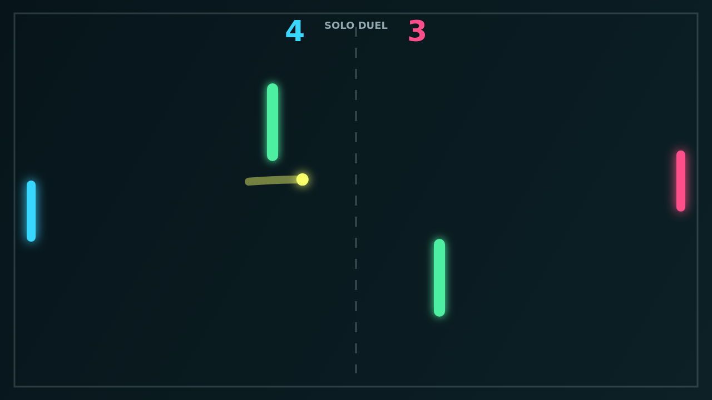

# Carom

Carom is a paddle duel about taking the clean return and making it strange. The
ball starts from the center, snaps into the rally, and immediately asks both
players to guard the straight shot while reading the two green bumpers in the
middle of the field.

The fun comes from spin. Slide the paddle through contact and the ball starts to
curve after the hit, turning simple saves into bending angles that clip a wall,
kiss an obstacle, or drift just behind the other paddle.

Solo mode gives you a steady AI opponent to practice against, while Versus turns
the same field into a shared-keyboard duel. Long rallies become small geometry
arguments: whether to smash through the lane, bank around the lower bumper, or
send a soft curling shot back across the net.

At match point, Carom is still readable at a glance: bright paddles, a glowing
ball trail, and the dark field underneath. The rules are simple, but the spin
keeps every return from feeling quite settled.
